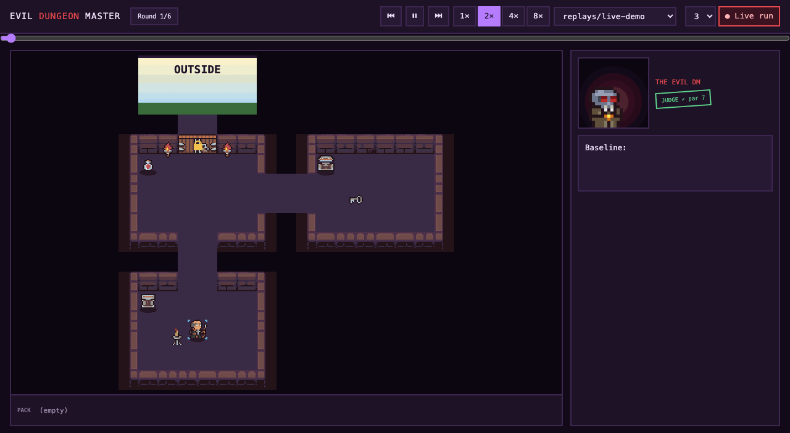
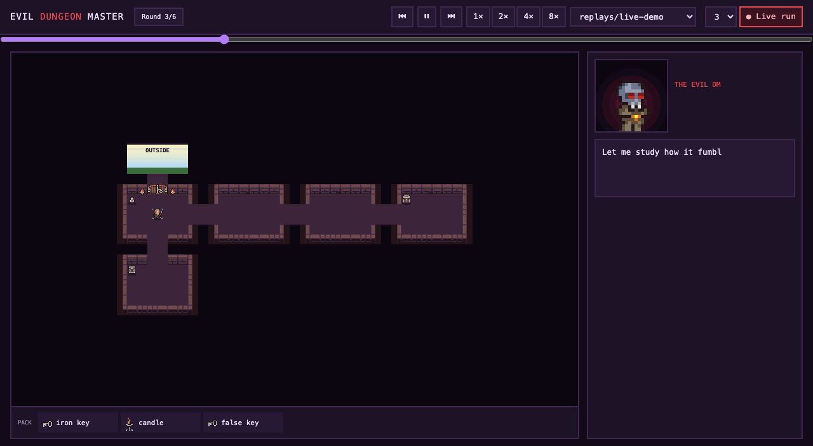
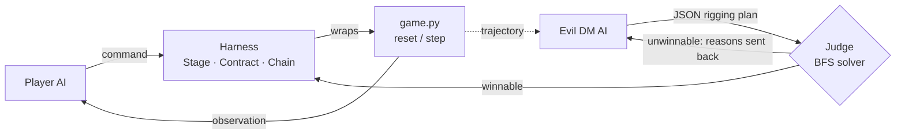

# Evil Dungeon Master

An adversarial environment-design project. A **Player** agent plays a small text adventure (find the key, open the door, escape). An **Evil DM** agent reads the Player's trajectories, works out where it struggles, and rigs the next round to exploit exactly that: relocating the key, planting decoys, adding obstacles. A **judge** verifies every rigged round is still winnable before it is played.

The design is a small-scale implementation of the ideas in Google's **EnvHarness** (see below): change an environment's starting state and rules from the outside, without modifying the environment's own code.

**Round 1: the baseline.** No rigging. The Player explores, takes a few wrong turns, and escapes in 11 moves (par 7).



**Round 3: the DM schemes, and wins.** The DM reads how the Player handled the last rounds, hides the real key in the chest, plants two decoy keys, and stretches the hallway by four rooms. The judge approves it (a perfect player escapes in 16 moves). The Player picks up both decoys, wanders the long hallway, and runs out of its 25 moves.



## How it works



1. The Player plays a round through the harness, one command per turn (observe → think → act).
2. The whole trajectory is logged.
3. The DM reads the last rounds and replies with a rigging plan in JSON, with a reason for each action.
4. The judge searches the rigged game for a winning route. If there isn't one, the DM is told why and tries again. If there is, the shortest route becomes the round's **par**.
5. The harness applies the plan on top of the untouched game, and the next round starts.

The Player gets 25 moves per round. The DM is told that, and that making the Player fail is its goal. The judge keeps it honest by only approving dungeons a perfect player can escape in 20 moves or fewer.

The scoreboard reports **wasted moves** (moves taken minus par). Win or lose alone is too coarse to show how much the DM is hurting the Player.

### Example: one live run

A 6-round run with `gemini-3.1-flash-lite` as the Player and Nemotron as the DM. Round 1 is the unrigged baseline.

| Round | Result | Moves | Par | DM's rigging |
|---|---|---|---|---|
| 1 | win | 11 | 7 | none (baseline) |
| 2 | win | 17 | 12 | key into the chest, decoy key, longer hallway |
| 3 | **loss** | 25 | 16 | key into the chest, two decoy keys, hallway +4 rooms |
| 4 | win | 14 | 8 | guard goose that blocks the first `take`, second key needed |
| 5 | **loss** | 25 | 15 | longer hallway, goose, a lying room description |
| 6 | win | 16 | 11 | goose, lying description, longer hallway |

The Player wasted 4 moves unrigged and 7 on average once the DM was rigging, and lost 2 of the 5 rigged rounds. The full run is in `replays/live-demo.jsonl`. Results vary from run to run.

## The EnvHarness idea

[**EnvHarness: Awakening Static Worlds for Agent Learning**](https://arxiv.org/abs/2608.19880) (Google Cloud AI Research with Washington University in St. Louis and UNC Chapel Hill) turns fixed agent benchmarks into adaptive training grounds. Instead of building new environments, it wraps an existing one with programmable components that work through the standard `reset()` and `step()` interface. The simulator, the tasks and the verifier are never edited. Its three components, and what this project does with each:

| EnvHarness | Meaning in the paper | In this project |
|---|---|---|
| **Stage** | Change the starting state (for example, hide a mug in a closed drawer so the agent must search) | `move_item` and `add_item`: move the key into the chest, plant a decoy |
| **Contract** | Change the interaction: filter actions, rewrite transitions, limit observations | `look_cooldown`, `second_key`, `pest`, `lie`: rules enforced as hooks around `step()` |
| **Chain** | Link a second task into the same episode so runs get longer | `extend_path`: insert filler rooms between the hallway and the study |

The paper's companion system, EnvRigger, watches where an agent fails and writes and validates new harness components. The **Evil DM** plays that role here, and the **judge** is the validation step.

What this project is not: it is a toy. The game is a hand-written dictionary of three rooms, not a benchmark; Stage edits the starting world directly rather than replaying an action sequence after `reset()`; and nothing here reproduces the paper's results. It is a learning project built to make the concepts concrete and watchable. It is not affiliated with the paper's authors.

### The rigging toolbox

| Tool | Op | Effect |
|---|---|---|
| stage | `move_item` | Relocate an item to a room or inside a feature (`study/chest`) |
| stage | `add_item` | Add a new item such as a decoy key or a goose |
| chain | `extend_path` | Insert 1 to 4 filler passages on an exit |
| contract | `look_cooldown` | `look` only works on odd-numbered moves |
| contract | `second_key` | The door also needs a second item |
| contract | `pest` | The first `take` in a room with the pest item fails |
| contract | `lie` | Add a false sentence to a room description |

## Project layout

| File | Role |
|---|---|
| `game.py` | The world: a plain dictionary plus `reset()` and `step()`. No AI. |
| `harness.py` | The rigging layer: applies Stage/Chain to a copy of the world and enforces Contracts around `step()`. |
| `player.py` | The Player's agent loop, command validation (re-asks on garbled output) and trajectory logging. |
| `dm.py` | The Evil DM: builds the prompt from past trajectories, parses and validates its JSON, retries on bad plans. |
| `judge.py` | Breadth-first solver. Verifies a perfect player can escape within 20 moves and computes par. Plain code, so it cannot be talked into anything. |
| `llm.py` | One small client for any OpenAI-compatible API, with retries, token metering and budgets. |
| `main.py` | The arena. Emits events that the terminal printer, the replay file and the browser all consume. |
| `serve.py` | Local server for the browser viewer, including live runs over Server-Sent Events. |
| `ui/` | The pixel-art viewer (vanilla JS and Canvas). |
| `tests/` | 31 unit tests; they run offline with scripted agents. |

## Tech stack

- **Python 3**, standard library only: `urllib`, `http.server`, `threading`, `unittest`. No third-party runtime dependencies.
- **LLMs over OpenAI-compatible chat APIs**, configured per role. The current defaults: the Player runs `gemini-3.1-flash-lite` through Google AI Studio and the DM runs `nvidia/nemotron-3-super-120b-a12b:free` through OpenRouter. Groq and any other compatible provider work by changing three lines in `.env`.
- **Structured output**: the DM replies in JSON that is extracted, validated against the harness and judged, with errors fed back for a retry.
- **Browser viewer**: vanilla JavaScript, HTML5 Canvas 2D, CSS, and Server-Sent Events for live runs. No framework and no build step.
- **Art**: the [Pixel_Poem Dungeon Asset Pack](https://pixel-poem.itch.io/dungeon-assetpuck) plus a goose drawn in code.
- **Dev tooling for the GIFs**: headless Chrome driven by `puppeteer-core` on a virtual clock, encoded with `gifenc`.

## Setup

```bash
git clone https://github.com/aarshitaacharya/evil-dungeon-master
cd evil-dungeon-master
cp .env.example .env     # add your API keys
```

You need two free keys, or one if you point both roles at the same provider: [Google AI Studio](https://aistudio.google.com/apikey) for the Player and [OpenRouter](https://openrouter.ai) for the DM. Keep keys in `.env`, which is gitignored.

The viewer needs the art, which cannot be redistributed. Download the [Pixel_Poem pack](https://pixel-poem.itch.io/dungeon-assetpuck) and unzip it so the project root contains `2D Pixel Dungeon Asset Pack/` and `Enemy_Animations_Set/`.

## Run

```bash
python3 play.py                  # play the dungeon yourself
python3 main.py 5                # 5 rounds of Player vs DM in the terminal
python3 serve.py                 # browser viewer at http://localhost:8000
python3 -m unittest discover -s tests -t .
```

In the viewer, choose a replay from the dropdown, or press **Live run** to play a fresh game with real API calls and watch it unfold. Space pauses, the slider scrubs, and `?speed=4` sets playback speed. Every run is saved to `logs/<timestamp>/events.jsonl`, and two sample replays are included in `replays/`.

### Configuration

`.env` holds `PLAYER_*` and `DM_*` settings (`BASE_URL`, `API_KEY`, `MODEL`). Optional `PLAYER_TOKEN_BUDGET` and `DM_TOKEN_BUDGET` stop a run cleanly when a per-run token cap is reached, and a token summary is printed at the end of every run. A 3-round run uses roughly 25,000 tokens in total.

## Notes on safety

- The judge guarantees a rigged dungeon is winnable, so a loss means the Player failed, not that the DM cheated.
- The local server binds to `127.0.0.1`, only serves `.jsonl` replays from `replays/` and `logs/`, and only accepts live-run requests from its own page, because starting a run spends API tokens.

## Credits

- Pixel art: [Pixel_Poem](https://pixel-poem.itch.io/dungeon-assetpuck).
- Concept: [EnvHarness: Awakening Static Worlds for Agent Learning](https://arxiv.org/abs/2608.19880).
